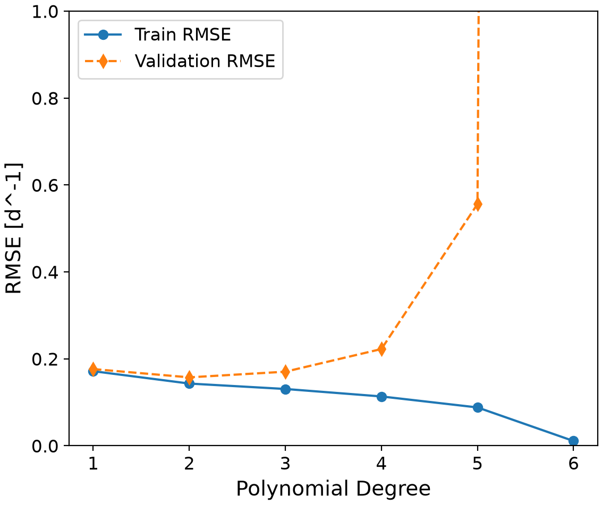
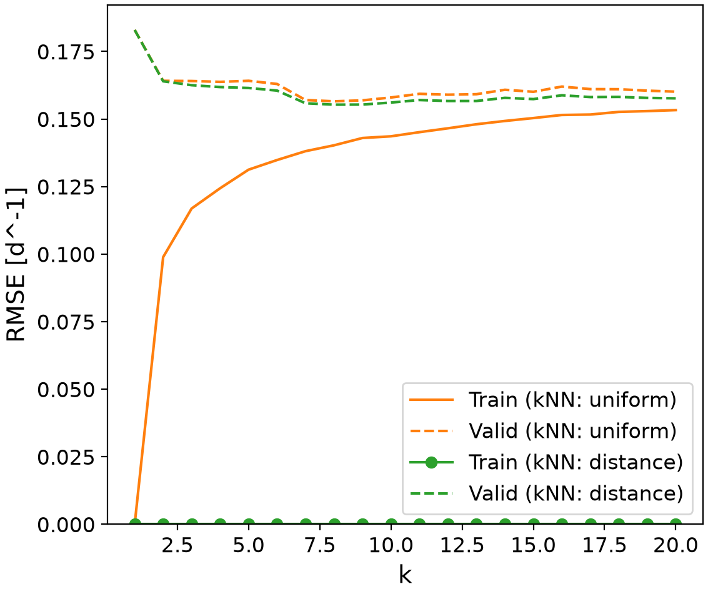
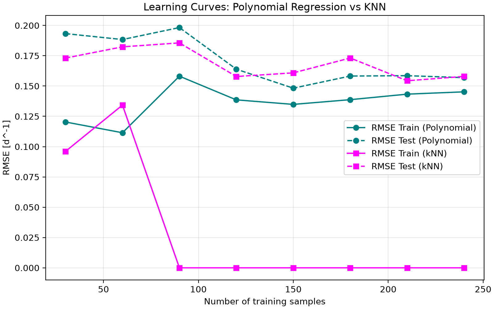

# Cell Growth Rate Prediction using Machine Learning
This project uses a Python-based machine learning approach to predict the specific growth rate of cells based on temperature, pH, glucose concentration, and lactate concentration. It models nonlinear relationships in biochemical data through data preparation, model training, hyperparameter optimization using cross-validation, and performance evaluation. Linear, polynomial, and k-nearest neighbors regression models are compared to determine an optimized model while evaluating the risks of overfitting and underfitting.
## Highlights
- Build scikit-learn pipelines for linear, polynomial and k-nearest neighbors regressions.
- Optimize hyperparameters using GridSearchCV and cross-validation.
- Evaluate bias-variance trade-offs using validation curves.
- Compare model performance using RMSE and R².
- Visualize learning behavior using learning curves.
## Environment
- Python 3.14.7
- Matplotlib 3.11.2
- Numpy 2.5.3
- Pandas 3.0.6
- Scikit-Learn 1.9.1
## Code Design
### Data Loading and Preprocessing
The program runs from main.py, and begins by importing the Python libraries required for data processing, machine learning, model evaluation, and visualization. Pandas loads datasets/dataset_cell_growth_4factor.csv into a DataFrame containing 318 observations. The program separates the four input features (temperature, pH, glucose concentration, and lactate concentration) from the target variable, specific growth rate (d⁻¹). The input features are stored in x, while the target values are stored in y.

The program then uses scikit-learn's train_test_split() function to divide the data into training and testing subsets, with test_size=0.2 and random_state=0. This creates a consistent 80/20 split, allowing the models to learn from the training data and be evaluated on observations excluded from training.

Data processing is a necessary first step as machine learning modelling depends on having the correct data and identifying which variables are used for prediction. 
### Linear Regression Baseline Model
The program then creates a linear regression model to establish a baseline for comparison with more complex models. Linear regression estimates the relationship between the four input features and the specific growth rate by fitting a linear equation to the training data. This was done using a scikit-learn pipeline, combining feature standardization (StandardScaler) with ordinary least squares regression (LinearRegression), fitting it to the training data and calculating training and test root mean squared error (RMSE) and the coefficient of determination (R²) metrics. RMSE measures the size of prediction errors, while R² shows the amount of variation in the target variable which is explained by the model. 

Although the model provides a useful starting point, its relatively low test R² suggests that linear relationships alone do not adequately capture the patterns in this dataset. This baseline establishes a reference point for evaluating whether polynomial regression and k-nearest neighbors can improve the model performance.
### Polynomial Regression and Hyperparameter Optimization
The program develops a polynomial regression model to capture nonlinear relationships between the input features and cell growth rate. Polynomial regression extends linear regression by adding polynomial combinations of the input features, allowing the model to represent more complex patterns in the data, which is common in biochemical growth processes. A scikit-learn pipeline is constructed using StandardScaler, PolynomialFeatures(include_bias=False), and LinearRegression in sequence. The grid search tests the polynomialfeatures__degree parameter at values from 1 to 6, using scoring="neg_root_mean_squared_error" to select the degree with the lowest cross-validation RMSE.

The model uses GridSearchCV to test the polynomial degrees (1 to 6) and 6-fold cross-validation (cv=6) evaluates each degree across different training and validation subsets, while RMSE is used to compare predictive performance. The degree with the lowest mean cross-validation RMSE is selected as optimal for the data. This search identifies degree 2 as the best polynomial model, with a mean cross-validation RMSE of approximately 0.1574 d⁻¹. 

Testing multiple polynomial degrees is important because increasing model complexity does not always improve predictions. Higher-degree models can fit the training data too closely and perform poorly on unseen observations. In this project, degrees 5 and 6 show substantially worse cross-validation errors, demonstrating the risk of overfitting. Hyperparameter optimization therefore helps select a model that captures nonlinear patterns without introducing unnecessary complexity. 
### k-Nearest Neighbors Regression and Optimization
The program next implements a k-nearest neighbors (kNN) regression model, which predicts cell growth rates based on observations with similar input feature values. Instead of fitting a fixed equation, kNN identifies the nearest training observations to a new sample and uses their target values to generate a prediction. The scikit-learn pipeline for this stage combines feature scaling with the kNN regressor, running a grid search across neighborhood sizes (k=1 to 20) and weighting (uniform vs. distance). The scaling is important since temperature, pH, glucose, and lactate concentration use different units and numerical ranges, thus scaling avoids disproportionately influencing distance calculations. 

Similarly to the polynomial regression, GridSearchCV is used with 6-fold cross-validation to optimize two parameters, the number of neighbors (1-20), and the weighting method (uniform vs. distance). RMSE is then used to select the configuration with the best cross-validation performance. 

In this model, the search identifies eight neighbors with distance-based weighting as the best configuration with a test RMSE of 0.1572 d⁻¹. Optimizing these hyperparameters is needed because not enough neighbors can make predictions sensitive to individual observations, while too many can ignore important patterns. Distance-based weighting gives closer observations greater influence on predictions. The resulting model provides an alternative to polynomial regression and allows the program to compare different approaches to modeling nonlinear relationships in the dataset.
### Model Validation Curves and Bias-Variance Analysis
The program generates validation curves to examine how changes in model hyperparameters affect predictive performance. For polynomial regression, the curve compares different polynomial degrees, while the k-nearest neighbors (kNN) curve compares different numbers of neighbors. Both plots show training and cross-validation RMSE to visualize the bias-variance tradeoff and identify regions of underfitting and severe overfitting, such as polynomial degree 6.

In the code, the validation curves are generated using scikit-learn's validation_curve() function. For polynomial regression, the program varies the polynomialfeatures__degree parameter, while for kNN, it varies the kneighborsregressor__n_neighbors parameter. The function evaluates each parameter value using cross-validation and returns training and validation scores. These scores are converted from negative RMSE values into positive RMSE values and plotted using Matplotlib.

The program saves these plots in the figures directory so they can be reviewed alongside the numerical results. Together, the validation curves provide visual evidence for hyperparameter selection and help explain the differences in performance between the two nonlinear regression models.

### Learning Curves and Performance Summary
Lastly, the program performs learning curves which iteratively train both polynomial and kNN models on increasing random subsets of training data, which calculates training and test errors at each incremental sample size. In this program, 30 to 240 samples was chosen as the training data. These values are stored in lists and plotted against the number of training samples using Matplotlib and saved in the figures directory.

Learning curves are useful for determining whether a model could benefit from additional observations and for identifying patterns associated with underfitting or overfitting.

Finally, the program compiles the test results for linear regression, polynomial regression, and kNN into a performance summary table. The table includes each model's selected settings, test RMSE, and test R². The summary is exported as a CSV file in the tables directory, allowing the results to be evaluated outside the program.

## Analysis
### Model Architecture Justification
The purpose of this machine learning project was to develop a model to predict specific cell growth rate using temperature, pH, glucose concentration and lactate concentration as input features. Three regression models were evaluated, including linear regression, polynomial regression, and k-nearest neighbors (kNN) regression. Although biological systems rarely exhibit purely linear behaviours, a linear regression was used as a baseline model as it's easy to implement, and represents a clear, insufficient model for capturing the dependencies of cell growth in response to environmental and nutrient changes. For example, cell growth may increase as temperature conditions reach an optimum, yet decrease when it moves above that range.

Polynomial regression was therefore evaluated to represent the nonlinear relationships by including higher-order terms of the input features. Lower polynomial degrees produce simpler relationships, while higher degrees allow for more complex patterns in the data to be fitted. The degree order was optimized using GridSearchCV, which evaluated polynomial degrees from 1 to 6 using six-fold cross-validation and root mean squared error (RMSE) as the scoring metric to prevent overfitting or underfitting. Underfitting occurs when a model is too simple to capture important patterns, resulting in relatively high errors on both training and validation data. Overfitting occurs when a model fits the training data too closely but performs less effectively on validation data. This is reflected by a larger gap between training and validation errors. Examining both errors helps explain why increasing model complexity does not necessarily improve predictive performance. Results of the hyperparameter optimization showed that a second-degree polynomial achieved the optimal bias-variance tradeoff. Extremely high degrees like degrees 5 and 6 introduced severe variance and overfitting, but were kept in the analysis to represent extreme cases of overfitting.

The kNN regression model provided a non-parametric alternative to predicting growth rate, as it makes no assumptions about the underlying functional form of the data and predicts based on similar input-feature values. Its performance depends on the number of neighbours considered and how their contributions are weighted. Grid search evaluated neighbour counts from 1 to 20 and compared uniform weighting with distance-based weighting. Standardization was included in the model pipeline because kNN relies on distances between observations, which can be affected when input features have different number scales. Optimization identified k = 8 with distance-based weighting as the optimal configuration. 

RMSE was used as the primary metric for comparing all three models because it can be applied consistently to each regression approach. The coefficient of determination, R², was also used to help interpret the performance of the linear and polynomial models.  
### Comparison of Regression Models
To evaluate the selected models, their performance was compared using test RMSE and R². RMSE measures the typical magnitude of prediction errors, with lower values indicating better predictive accuracy. The R² score indicates how much of the variation in the observed growth rates is explained by the model, with values closer to 1 generally indicating better performance.

##### Summary Table
| Model Type | Best Settings | Test RMSE (d⁻¹) | Test R² |
|---|---|---:|---:|
| Linear Regression | Baseline | 0.1907 | 0.0917 |
| Polynomial Regression | Degree = 2 | 0.1570 | 0.3841 |
| kNN Regression | k = 8, distance weighting | 0.1572 | 0.3827 |

The linear regression model had the highest test RMSE of 0.1907 d⁻¹ and the lowest R² of 0.0917. This demonstrates how the base model had poor predictive performance and captured little variation in specific growth rate. This validates the reasoning for linear relationships not being representative of the relationship between the four input features and cell growth rate. 

Polynomial regression with a degree of 2 achieved the lowest test RMSE of 0.1570 d⁻¹ and the highest R² of 0.3841 of the three models. Its test RMSE was much lower than that of the linear regression model, demonstrating an improvement in predictive accuracy. The optimized kNN model achieved a test RMSE of 0.1572 d⁻¹ and an R² of 0.3827. These results were very similar to those of polynomial regression, indicating that both approaches captured patterns that the linear baseline did not represent. Since the Polynomial and kNN models had nearly identical test performance, preference is given to the simpler or more interpretable model. For example, if the Polynomial regression of degree 10 was compared to a kNN regression with k = 5, regardless of whether the Polynomial's RMSE is slightly better, it would likely not be chosen due to its high degree complexity. Overall, the second-degree polynomial was selected as the preferred model because it achieved the best test-set metrics while maintaining a relatively simple structure. Due to its low degree and its parametric structure, it is favoured over the kNN regression since kNN requires indirect visual inspection techniques and making it slightly more complex. Nevertheless, both models have limitations since their R² values show some variation in growth rate predictions.

- The polynomial validation curve justifies selecting degree 2 by demonstrating a stable error profile, while overfitting occurs at higher degrees.
##### Polynomial Regression Validation Curve

- The kNN validation curve demonstrartes how validation error stabilizes around k=8.
##### k-Nearest Neighbors Validation Curve

- The learning curve analysis confirms that testing errors converge downward as training sample sizes expand from 30 to 240, explaining model scalability. 
##### Learning Curve

### Advantages and Disadvantages
The selected degree-two polynomial regression model can represent nonlinear relationships between temperature, pH, glucose concentration, lactate concentration, and specific growth rate. This is useful for modelling cell culture systems because growth depends on multiple interacting environmental and nutritional factors.
- Polynomial Regression (Degree 2)
  - Advantages: Captures nonlinear behaviour while remaining less complex than higher-degrees. Allows model to represent curvature and interactions between input features. Computationally not very difficult and produces smooth continuous predictions.
  - Disadvantages: Sensitive to outliers in data. This could be due to factors such as dissolved oxygen or cell metabolism conditions, which explain the lower R² value. When outside of the training data range, it can produce unrealistic predictions when extrapolating.    

1. Temperature influences cell metabolism, enzyme activity and reaction kinetics. Within a suitable operating range, increasing temperature may improve growth until an optimum is approached. However, exceeding an optimal threshold causes rapid protein denaturation and cell death, leading to a sharp decline in growth. 
2. pH affects the enzyme function and shape, as fluctuating pH can break the enzyme's hydrogen and ionic bonds. Calls also maintain a homeostasis, and when pH is disrupted, the cellular metabolism is inhibited. Growth is generally favoured within a suitable pH range, while excessively acidic or alkaline conditions can inhibit cellular activity. 
3. Glucose concentration is the primary carbon and energy source for cells. Insufficient glucose may limit growth, whereas increasing glucose does not necessarily produce a continuous increase in growth rate. Very high concentrations can disrupt metabolism and cause oxidative stress on the cell. 
4. Lactate concentration is a metabolic by-product of glycolysis (glucose metabolism). Elevated lactate concentrations may inhibit growth through effects such as acidification and metabolic stress, which inhibits growth rate.   

Based on these general biological relationships, high specific growth rates would be expected under conditions where temperature and pH are near the cell's optimal operating ranges, glucose is sufficiently available, and lactate accumulation is limited. Therefore, the model's predictions may be unreliable when temperature, pH, glucose, or lactate concentrations fall outside the ranges represented in the training dataset. Additionally, the model may not accurately predict growth rates under conditions involving extreme temperatures or pH values, glucose limitation, or excessive lactate accumulation. The model also does not account for other environmental factors and variables such as dissolved oxygen or culture duration.   

Overall, the polynomial regression model provides a useful starting point for predicting specific growth rate from selected culture variables, but should be compared with experimental measurements to ensure accuracy. 

### Practical Applications
Machine learning models predicting growth rates are often used in industrial biotechnology and biomanufacturing plants. This model could be used as a decision tool for evaluating cell culture conditions and estimating specific growth rate from temperature, pH, glucose concentration, and lactate concentration. In practice, a user could enter measured or proposed culture conditions into the trained model to get an estimated growth rate without conducting a new experiment for every combination of inputs. This tool would be especially useful for reducing the number of experimental conditions needing to be tested, and thereby reducing subsequent costs.

This model can also act as a bioreactor controller, where it can predict shifts in growth rate based on sensor streams like pH and temperature probes. From these predictions, feeding pumps can adjust nutrient delivery or substrate concentrations.

Since the majority of bioprocessing is performed in batch reactors, this model could aid in glucose addition schedules by optimizing the biomass accumulation while minimizing the lactate production.

#### Resources
Clark, J., & Harvey, D. (2025). 10.7: The effect of pH on enzyme kinetics. In *Physical chemistry for the biosciences*. Chemistry LibreTexts. https://chem.libretexts.org/Bookshelves/Physical_and_Theoretical_Chemistry_Textbook_Maps/Physical_Chemistry_for_the_Biosciences_%28LibreTexts%29/10%3A_Enzyme_Kinetics/10.07%3A_The_Effect_of_pH_on_Enzyme_Kinetics

Koziel, A., Woyda-Ploszczyca, A., Kicinska, A., & Jarmuszkiewicz, W. (2012). The influence of high glucose on the aerobic metabolism of endothelial EA.hy926 cells. *Pflügers Archiv - European Journal of Physiology, 464*(6), 657–669. https://doi.org/10.1007/s00424-012-1156-1
